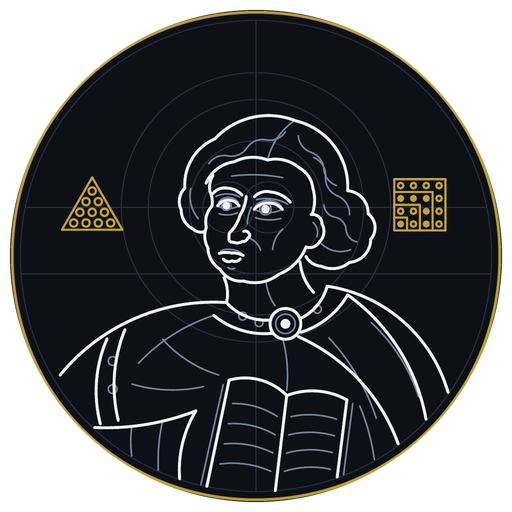
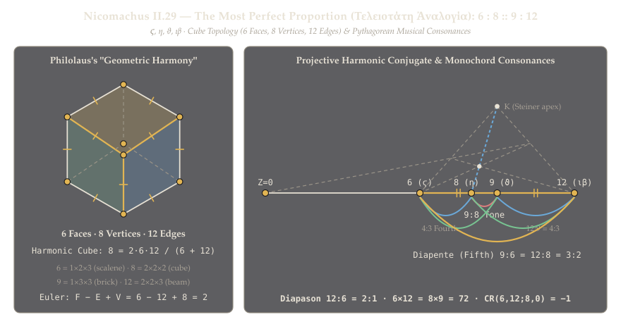

<a href="https://geometor.github.io/nicomachus/"></a>

# GEOMETOR • nicomachus

**Visit the Online Archive:** https://geometor.github.io/nicomachus/

<p align="center">
  <a href="https://geometor.github.io/nicomachus/"></a>
</p>

**Nicomachus of Gerasa • Introduction to Arithmetic • semantic digital archive**

## Mission

`geometor/nicomachus` is part of the interconnected [GEOMETOR](https://geometor.com) semantic digital archive. It preserves Nicomachus of Gerasa's foundational Greek treatise *Introduction to Arithmetic* (*Ἀριθμητικὴ Εἰσαγωγή*), which established the classical Quadrivium curriculum through the systematic theory of figurate numbers, polygonal gnomons, ratio unfolding from equality, and ten Neo-Pythagorean means. Through addressable semantic units, calibrated theme-adaptive vector diagrams, primary-source folio provenance, and exact SymPy symbolic algebra, Nicomachus's arithmetical geometry connects ancient Pythagorean number theory to modern constructive algebra across the GEOMETOR corpus.

## Books in This Archive

- [Introduction to Arithmetic](https://geometor.github.io/nicomachus/introductio_arithmetica/) — Foundational Pythagorean exposition of arithmetic, figurative numbers, ratios, and proportion theory (Hoche 1866 & D'Ooge 1926).

## Repository Contents

- `docsrc/` — RST documentation source, 4-track study codex, and Sphinx docs compiled by [PHOTON publish](https://github.com/photon-platform/publish).
- `resources/` — Primary-source folios, Teubner Greek and Macmillan facsimiles, and apparatus registries.
- `src/geometor/nicomachus/` — Exact SymPy modules for the tree of equality, figurate numbers, gnomons, and Neo-Pythagorean means.

## Local Build & Verification

```bash
publish build
uv run --no-sync pytest
```
## Part of the GEOMETOR Knowledge Archive

Explore all **74 Book Codices** and **11 Mathematical Catalogs** at https://geometor.com/books/.
