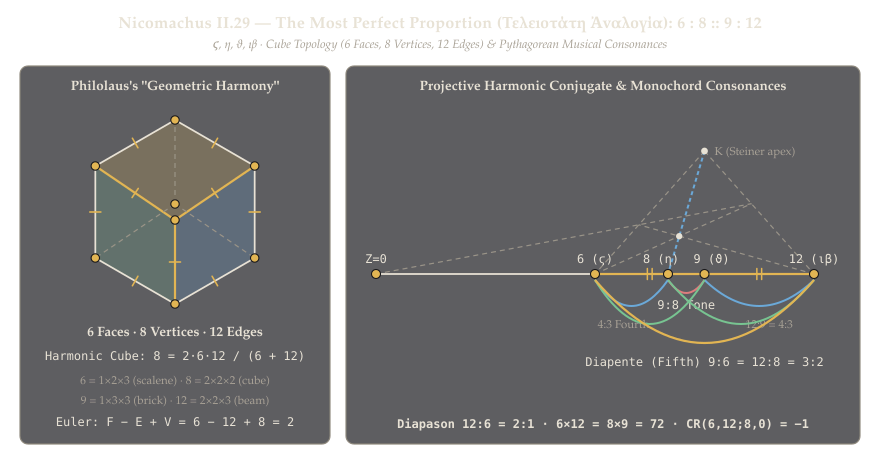

GEOMETOR • nicomachus
=====================

**Visit the Online Archive:** https://geometor.github.io/nicomachus/

**Nicomachus of Gerasa • Introduction to Arithmetic • semantic digital archive**

Mission
-------

``geometor/nicomachus`` is part of the interconnected `GEOMETOR <https://geometor.com>`_ semantic digital archive. It preserves Nicomachus of Gerasa's foundational Greek treatise *Introduction to Arithmetic* (*Ἀριθμητικὴ Εἰσαγωγή*), which established the classical Quadrivium curriculum through the systematic theory of figurate numbers, polygonal gnomons, ratio unfolding from equality, and ten Neo-Pythagorean means. Through addressable semantic units, calibrated theme-adaptive vector diagrams, primary-source folio provenance, and exact SymPy symbolic algebra, Nicomachus's arithmetical geometry connects ancient Pythagorean number theory to modern constructive algebra across the GEOMETOR corpus.

Books in This Archive
---------------------

- `Introduction to Arithmetic <https://geometor.github.io/nicomachus/introductio_arithmetica/>`_ — Foundational Pythagorean exposition of arithmetic, figurative numbers, ratios, and proportion theory (Hoche 1866 & D'Ooge 1926).

Python Package & Modules
------------------------

The ``geometor-nicomachus`` Python package (``import geometor.nicomachus``) provides the executable symbolic geometry, construction, and compilation modules powering this archive:

- ``equality_tree.py`` — Nicomachus's Rule of Three Terms & Reduction to Equality (Book I, Chs. 17–23; Book II, Chs. 1–2).
- ``figurate_gnomons.py`` — Sieve, Perfect Numbers, Polygonal Gnomons & Nicomachus's Cubes Theorem (Book I.13–16; Book II.6–20).
- ``ten_means_and_cube.py`` — Ten Nicomachean Proportions & the Cube Harmony 6 : 8 :: 9 : 12 (Book II, Chs. 21–29).
- ``sphinx_ext.py`` — Runtime Sphinx & photon-platform/publish integration for GEOMETOR Nicomachus.

See the `API Reference <https://geometor.github.io/nicomachus/modules/>`_ for full module documentation.

Repository Contents
-------------------

- ``docsrc/`` — RST documentation source, 4-track study codex, and Sphinx docs compiled by `PHOTON publish <https://github.com/photon-platform/publish>`_.
- ``resources/`` — Primary-source folios, Teubner Greek and Macmillan facsimiles, and apparatus registries.
- ``src/geometor/nicomachus/`` — Exact SymPy modules for the tree of equality, figurate numbers, gnomons, and Neo-Pythagorean means.

Local Build & Verification
--------------------------

.. code-block:: bash

   publish build
   uv run --no-sync pytest

Part of the GEOMETOR Knowledge Archive
--------------------------------------

Explore all **74 Book Codices** and **11 Mathematical Catalogs** at https://geometor.com/books/.
