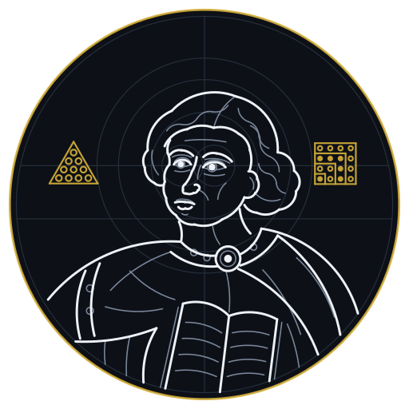

:site_title: Nicomachus of Gerasa

.. container:: author-overline

   semantic digital archive • the works of

====================
Nicomachus of Gerasa
====================

:person:`Nicomachus of Gerasa <nicomachus>` (c. 60 – c. 120 CE) shaped a millennium of mathematical education by presenting arithmetic as the philosophy of number, ratio, and harmony—the foundation of the classical Quadrivium. This archive pairs Richard Hoche's critical Greek text and Martin Luther D'Ooge's English translation of the *Introduction to Arithmetic* with calibrated vector diagrams and exact SymPy demonstrations.

Works in This Archive
---------------------

.. container:: home-book-hero

   .. container:: home-book-thumb

      .. image:: _static/figures/cube-most-perfect-proportion.svg
         :alt: Cube and most perfect musical proportion in Nicomachus
         :target: introductio_arithmetica/index.html

   .. container:: home-book-body

      .. rubric:: Hoche 1866 & D'Ooge 1926 · Books I–II · Boethius Parallel

      **Introduction to Arithmetic (*Ἀριθμητικὴ Εἰσαγωγή*)** — Surveys the classification of even, odd, and perfect numbers (via the Sieve of Eratosthenes), the five species of inequality unfolded from equality, polygonal and solid figurate numbers, and the ten Neo-Pythagorean means culminating in the *most perfect* musical proportion.

      .. container:: home-actions

         * :doc:`Open Introduction to Arithmetic → <introductio_arithmetica/index>`
         * :doc:`Book I (Number & Ratio) → <introductio_arithmetica/book_01/index>`
         * :doc:`Book II (Figurate & Means) → <introductio_arithmetica/book_02/index>`

Key Features
------------

.. container:: home-feature-grid

   .. container:: home-feature-card

      **Four-Track Greek & English Codex**

      Read every chapter across synchronized **English** (D'Ooge), critical **Greek** (Hoche), **Summary**, and **Notes** tracks, collated with Boethius's *De Institutione Arithmetica*.

   .. container:: home-feature-card

      **Exact Symbolic Number Geometry**

      Explore executable SymPy models of the tree of equality, polygonal gnomon sums, cubes as sums of odd numbers, and the ten Neo-Pythagorean means in :doc:`Symbolic Demos <demos/index>`.

   .. container:: home-feature-card

      **9 Calibrated Geometric Plates**

      Vector diagrams illustrate the Quadrivium tetrad, the sieve for perfect numbers, alpha-gnomons, heteromecic growth, and the musical cube proportion.

Reference & Project
-------------------

.. container:: home-columns

   .. container:: home-col

      .. rubric:: Scholarly Apparatus

      * :doc:`People <introductio_arithmetica/people/index>` — Nicomachus, Pythagoras, Plato, Eratosthenes, Boethius, Hoche, and D'Ooge
      * :doc:`Concordance <introductio_arithmetica/concordance>` & :doc:`Bibliography <introductio_arithmetica/bibliography>` — Hoche–D'Ooge–Boethius mapping and critical editions
      * :doc:`Glossary <introductio_arithmetica/glossary>` — Greek arithmetic, ratio, and harmonic terminology

   .. container:: home-col

      .. rubric:: About This Project

      * :doc:`About <about/index>` — Scope, sources, and editorial methodology
      * :doc:`Using This Edition <usage/index>` — Reading guide, track switching, and diagram controls
      * :doc:`Demos <demos/index>`, :doc:`Log <log/index>`, & :doc:`Modules <modules/index>` — Symbolic demos, journal, and API reference

.. toctree::
   :hidden:
   :maxdepth: 2

   introductio_arithmetica/index
   demos/index
   about/index
   usage/index
   log/index
   changelog
   modules/index
